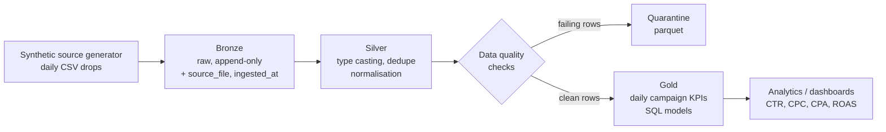

# Medallion ETL Pipeline

An end-to-end data engineering project that builds a **bronze → silver → gold
medallion architecture** for advertiser performance data (impressions, clicks,
spend, conversions, revenue) — the same layered pattern used in production
lakehouse platforms, implemented here to run **entirely locally** with no
cloud account: Python + pandas, Parquet files on disk, and SQL for the gold
models.

## Architecture



| Layer | What happens | Output |
|---|---|---|
| **Source** | Generates 30 days of campaign/channel performance data — with realistic defects injected on purpose (duplicates, nulls, negative values, messy campaign names) | `data/raw/events_YYYY-MM-DD.csv` |
| **Bronze** | Lands raw files untouched (all values kept as strings), adding only lineage: `source_file` and `ingested_at` | `data/bronze/events.parquet` |
| **Silver** | Casts types, normalises campaign names, de-duplicates on `event_id`, runs data-quality checks; failing rows are **quarantined**, not silently dropped | `data/silver/events.parquet`, `data/silver/quarantine.parquet` |
| **Gold** | SQL model aggregates silver to one row per campaign per day with KPI metrics: CTR, CPC, cost per conversion, ROAS, conversion rate | `data/gold/daily_campaign_kpis.parquet` |

## Quick start

```bash
pip install -r requirements.txt
python -m src.run_pipeline
python -m pytest tests/ -v
```

## Sample output

```
== 2/4 Bronze: raw ingestion ==
[bronze] 30 files -> 606 rows -> data/bronze/events.parquet
== 3/4 Silver: cleanse + data quality ==
[silver][dq] FAIL null_spend: 6 violating row(s)
[silver][dq] FAIL null_conversions: 5 violating row(s)
[silver][dq] FAIL negative_impressions: 5 violating row(s)
[silver][dq] PASS negative_spend: 0 violating row(s)
[silver] duplicates removed: 6, quarantined: 16, clean rows: 584
== 4/4 Gold: campaign KPI aggregates ==
[gold] 150 campaign-day rows -> data/gold/daily_campaign_kpis.parquet

event_date campaign_id campaign_name    impressions clicks   spend   conversions revenue  ctr_pct  cpc   roas
2026-09-30 C001        Spring Sale      267632      13962    26686.51 1263        55146.64 5.22     1.91  2.07
2026-09-30 C003        App Installs     230774      8265     7781.90  698         38980.17 3.58     0.94  5.01

Total spend (gold): $2,481,097.55 | Total revenue (gold): $6,505,921.99 | Blended ROAS: 2.62
```

## Project structure

```
├── src/
│   ├── generate_data.py   # synthetic advertiser data + injected defects
│   ├── bronze.py          # raw ingestion with lineage metadata
│   ├── silver.py          # cleansing, dedupe, data-quality checks, quarantine
│   ├── gold.py            # executes the SQL gold model (SQLite, stdlib)
│   └── run_pipeline.py    # orchestrates all four steps
├── sql/
│   └── gold_daily_campaign_kpis.sql   # gold aggregate model (dbt-style SQL)
├── dags/
│   └── medallion_etl_dag.py           # Airflow DAG calling the same modules
├── tests/
│   └── test_pipeline.py   # 5 tests: lineage, dedupe, DQ, reconciliation, grain
├── requirements.txt
└── data/                  # generated at runtime (git-ignored)
```

## Design choices

- **Medallion layering** — each layer has one job: bronze preserves the raw
  truth, silver makes it trustworthy, gold makes it useful. Any gold number
  can be traced back to a raw file through the lineage columns.
- **Data quality as a gate, not an afterthought** — every check prints
  PASS/FAIL with a violating-row count, and bad rows land in a quarantine
  file for inspection instead of disappearing.
- **SQL for gold, Python for the rest** — the gold aggregates live in a
  versioned `.sql` model (the dbt pattern), executed against SQLite so the
  project needs zero warehouse setup. Swapping SQLite for Snowflake/DuckDB
  later only changes `src/gold.py`.
- **One codebase, two runners** — the Airflow DAG in `dags/` calls the same
  functions as the local runner, so scheduling can never drift from the
  tested code path.
- **Tests reconcile the layers** — the suite proves dedupe works, the
  quality checks actually catch the injected defects, and gold totals tie
  back to silver to the cent.

## Tech stack

Python · pandas · PyArrow (Parquet) · SQL (SQLite) · Apache Airflow (DAG) ·
pytest

## Tests

```bash
python -m pytest tests/ -v   # 5 passed
```

---

*Personal portfolio project by Santhosh Reddy Angiti — Data Engineer
(Python, SQL, ETL pipelines, data quality). Synthetic data only; no real
advertiser data is used.*
